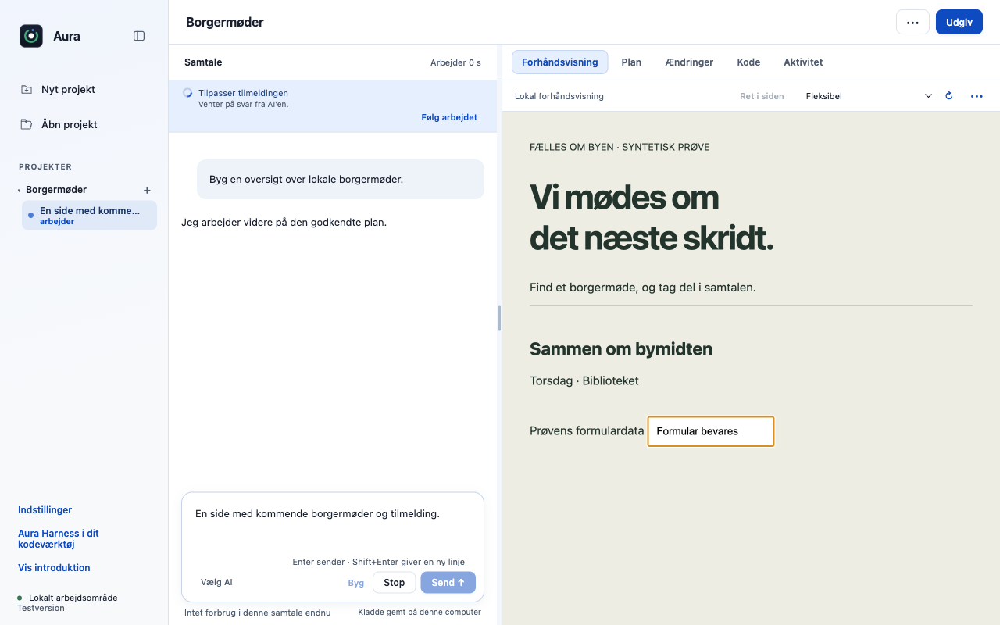
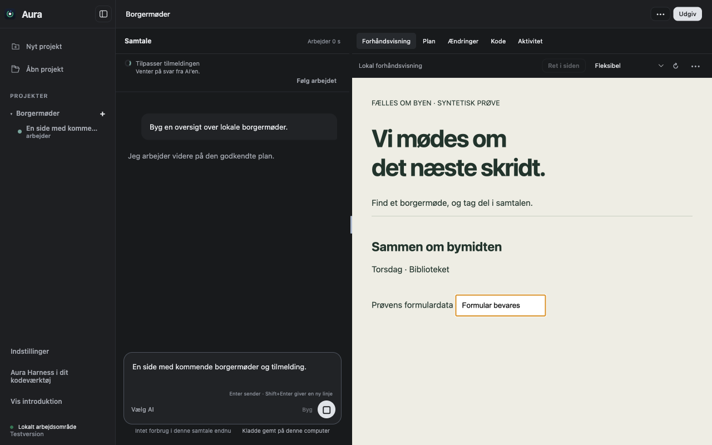
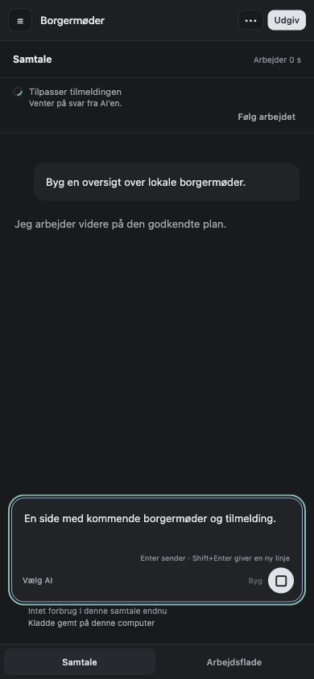
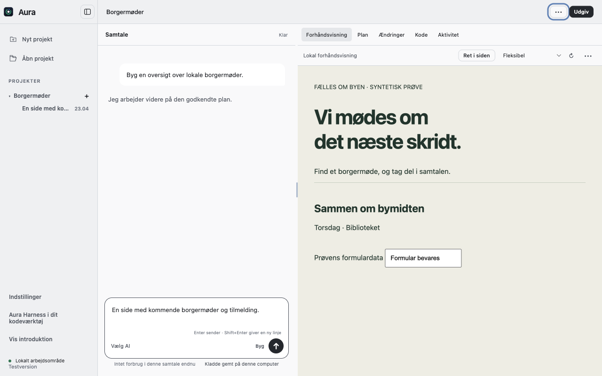

# Giv arbejdsvisningen et roligt og responsivt mørkt layout

Arbejdsvisningen får den godkendte mørke æstetik med kompakt samtale, tydelige paneler og mindre visuel støj. På små vinduer kan brugeren skifte mellem samtale og arbejdsflade i stedet for at miste indhold uden for vinduet.

## Før og efter

| Før | Efter |
|---|---|
| Den eksisterende arbejdsvisning bruger mere plads på rammer og kontroller og har ikke den nye kompakte paneladfærd. | Mørk arbejdsvisning er standard, lys visning kan vælges og huskes, og både samtale, sidepanel og forhåndsvisning kan nås ved smalle vinduer. |

| Tidligere arbejdsvisning | Godkendt mørk arbejdsvisning |
|---|---|
|  |  |

### Mobilbredde



### Valgfri lys visning



## Adfærd og bevaring

- Ændringerne er afgrænset til arbejdsvisningen. Onboarding og dens godkendte layout forbliver uden dette tema.
- Projektmenuen rummer temavalget. Responsivt panelskift og Escape på sidepanelet understøtter små vinduer; skjulte paneler er også skjult for tastaturfokus.
- Eksisterende samtaler, planer, funktioner og godkendelser bruger samme logik. Den særskilte status oven på forhåndsvisningen leveres i et andet PR.
- Det er den godkendte visuelle retning fra forkens arbejdsprototype, tilpasset originalens eksisterende elementer.

## Test

21 native Electron-kontroller består ved 1280, 980, 720, 390 og 320 pixels: ingen udklipning af chatfelt, adgang til arbejdsflade/sidebar, tastaturfokus, lys/mørk persistens og uændret onboarding.

Prøverne er kørt lokalt på macOS Apple Silicon med Node 22.23.3 og appens låste afhængigheder. De er ikke en påstand om grøn GitHub CI.

Originalens uændrede main har 514/516 beståede desktoptests. To eksisterende fixtures i `approvals.test.cjs` (linje 47 og 74) fejler også uden dette PR. Den isolerede branches fulde testlog er vedlagt; disse to fejl er ikke skjult eller sprunget over.

```sh
node desktop/scripts/verify-contribution-new.cjs . calm calm-workspace-after
# Hele desktop-pakken:
cd desktop && node --test --test-concurrency=1 tests/*.test.cjs
```

Evidens: [full.tap](full.tap), [native.json](native.json).

## Integration

Den lokale samlingsprøve med de tidligere 24 bidrag, de ti opdateringer og disse syv nye bidrag består **746/746 desktoptests og 27/27 CLI-tests**. Den bruger forkens integrerede grundlag; fælles filer er flettet med bevarede bindinger, og alle 23 skill-eksporter er genbygget. Det er ikke en påstand om konfliktfri automatisk merge eller grøn hosted CI. [Manifest](integration.json), [desktoplog](integration-desktop.tap) og [CLI-log](integration-cli.tap).

Kan gennemgås uden de øvrige UI-PR’er. Ved kombination bevares F20 (#17), glow (#18), modelbranding (#22), plusmenu (#29/#30/#38/#40) og deres eventhandlers. Samlingsprøven inkluderer disse.

Originalt sammenligningspunkt: `dce68ea74a199ca214ab535a16ff22765d8ee8de`. Funktionerne er udskilt fra den godkendte fork-implementering `fa223d3b2ceb6f27e5fecf4c13f590913801036c`; originalens navn, runtimeversion og øvrige produktfunktioner bevares.

## Afgrænsning

UI-prøven bruger den rigtige app og lokale syntetiske projekter. Arbejdsstatus er sat kontrolleret for et reproducerbart screenshot; billederne er ikke bevis for et eksternt AI-byggeforløb.
