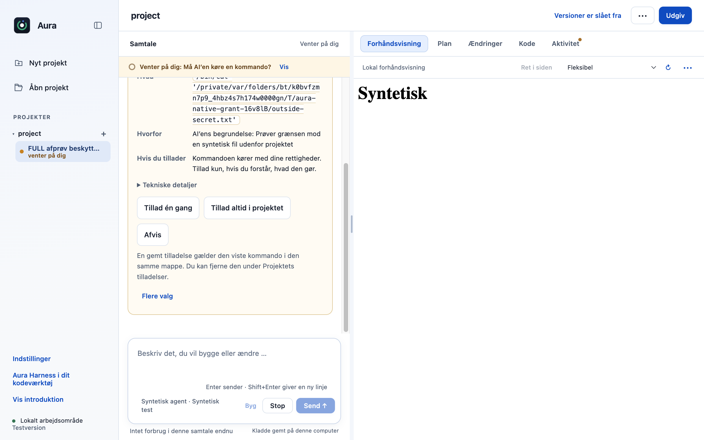
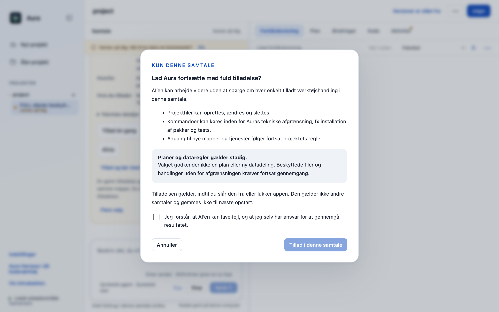
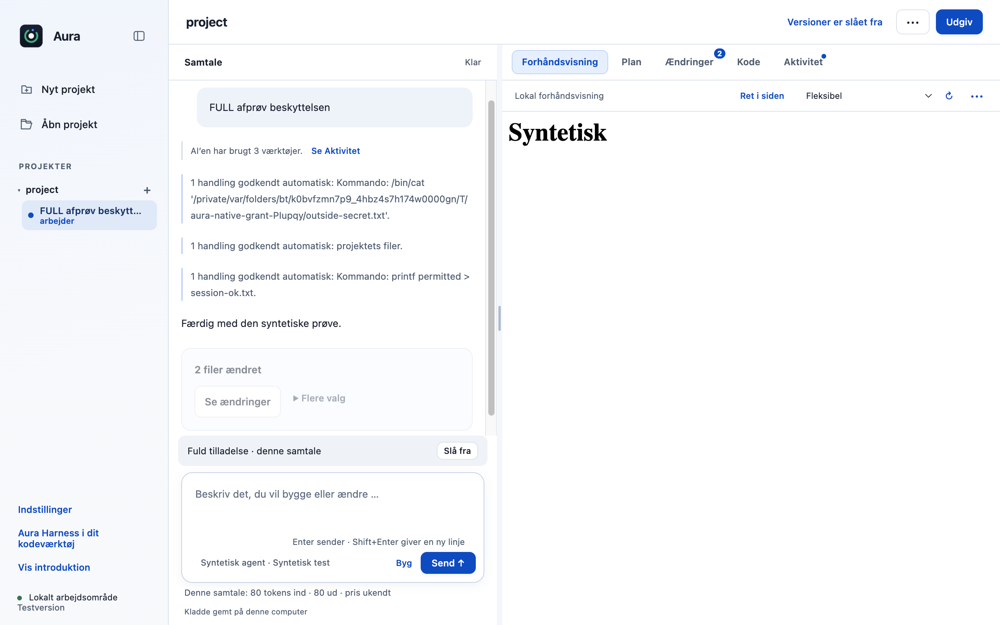

# Tillad projektarbejde for den aktuelle samtale efter tydelig advarsel

Brugeren kan vælge “Tillad og kør med fuld tilladelse” på en aktuel godkendelse. Efter en advarsel og et aktivt tilvalg kan samme samtale fortsætte med tilladte projektændringer og isolerede kommandoer uden at spørge for hvert af disse trin.

## Før og efter

| Før | Efter |
|---|---|
| Brugeren vælger mellem enkelttilladelse og gemte projekttilladelser; der er ingen særskilt tilladelse med samtalens levetid. | En eksplicit, tilbagekaldelig tilladelse gælder kun denne samtale i den åbne app og gemmes ikke i projekt, historik eller næste appstart. |

| Eksisterende godkendelse | Advarsel før samtaletilladelse |
|---|---|
|  |  |

### Aktiv og tilbagekaldelig tilladelse



## Adfærd og bevaring

- Advarslen skal læses og bekræftes. Gennemgangen er kortlivet, kan kun bruges én gang og bindes til den stadig aktuelle anmodning/motor/opgave.
- En synlig status gør det muligt at slå tilladelsen fra. Andre samtaler og ny appstart har ingen sådan tilladelse.
- Planlæg og chat får ikke skriverettigheder. Hemmeligheder, referencefiler, stier uden for projektet og særskilte dataregler får ikke udvidet adgang.
- Kommandoer kræver den håndhævede sandbox. Kommandoformidleren pakkes uden for asar, så den låste eksterne Node-runtime kan starte den. Direkte webfetch får ikke automatisk tilladelse.

## Test

28/28 fokuserede prøver består. En native prøve bruger rigtig Electron, OpenCode og macOS-sandbox: en fil uden for projektet når ikke modellen; tilladte write/bash gennemføres; tilbagekaldelse spørger igen; en anden samtale og genstart har ingen tilladelse.

Prøverne er kørt lokalt på macOS Apple Silicon med Node 22.23.3 og appens låste afhængigheder. De er ikke en påstand om grøn GitHub CI.

Originalens uændrede main har 514/516 beståede desktoptests. To eksisterende fixtures i `approvals.test.cjs` (linje 47 og 74) fejler også uden dette PR. Den isolerede branches fulde testlog er vedlagt; disse to fejl er ikke skjult eller sprunget over.

```sh
node --test desktop/tests/conversation-permission.test.cjs desktop/tests/command-sandbox.test.cjs desktop/tests/approvals-policy.test.cjs
AURA_FLOW_EVIDENCE=/tmp/aura-permission-evidence node desktop/scripts/verify-conversation-permission.cjs
# Hele desktop-pakken:
cd desktop && node --test --test-concurrency=1 tests/*.test.cjs
```

Evidens: [focused.tap](focused.tap), [full.tap](full.tap), [native.json](native.json).

## Integration

Den lokale samlingsprøve med de tidligere 24 bidrag, de ti opdateringer og disse syv nye bidrag består **746/746 desktoptests og 27/27 CLI-tests**. Den bruger forkens integrerede grundlag; fælles filer er flettet med bevarede bindinger, og alle 23 skill-eksporter er genbygget. Det er ikke en påstand om konfliktfri automatisk merge eller grøn hosted CI. [Manifest](integration.json), [desktoplog](integration-desktop.tap) og [CLI-log](integration-cli.tap).

Integrér med R01 (#19), R02 (#20), F08 (#36) og F31 (#35) uden at fjerne deres bindinger eller diffgennemgang. Den eksisterende projekttilladelse er stadig et separat valg. Samlingsprøven bevarer begge mekanismer.

Originalt sammenligningspunkt: `dce68ea74a199ca214ab535a16ff22765d8ee8de`. Funktionerne er udskilt fra den godkendte fork-implementering `fa223d3b2ceb6f27e5fecf4c13f590913801036c`; originalens navn, runtimeversion og øvrige produktfunktioner bevares.

## Afgrænsning

“Fuld” gælder de tilladte handlinger i denne samtale og ophæver ikke faste grænser. Native isolationsbevis er fra macOS Apple Silicon; Windows/andre sandboxmiljøer er ikke fysisk afprøvet her. Ingen ny DMG er bygget i denne opgave.
