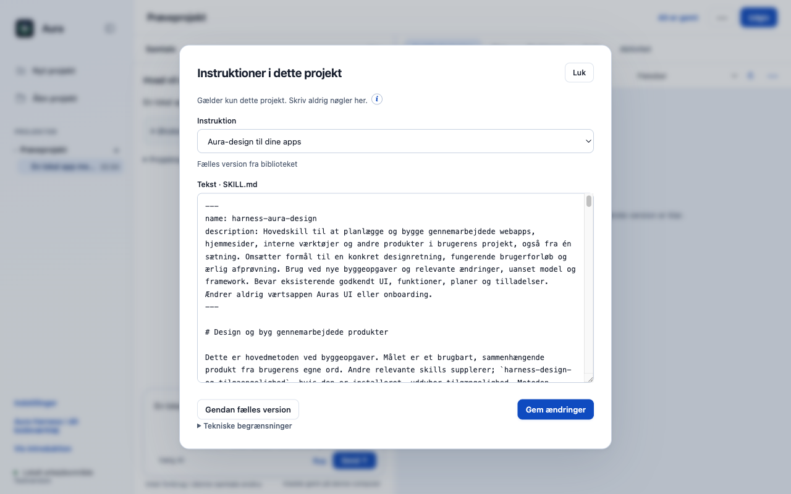

# feat: add a reviewed primary app design method to the shared library

Tilføjer harness-aura-design til det fælles skillbibliotek. Metoden omsætter også en enkelt sætning til et konkret brugerforløb, et sammenhængende design og en ærlig afprøvning. Den fulde leverede byggevejledning supplerer brandresearch, tokens, tilgængelighed, appmønstre og 43 beskrevne designretninger.

## Bevaring og afgrænsning

Indholdet følger det eksisterende globale/projektvise Design og tilgængelighed-valg og kan læses, tilpasses, nulstilles og eksporteres. 17 passive Markdown-filer og 23 reproducerbare eksportpakker. Automatisk indlæsning før modelkald er et separat bidrag; denne PR ændrer ikke motor, Auras UI eller tilladelser. Netværksscanner og filserver fra kilden medfølger ikke. EUPL-1.2 og MIT-notice/proveniens bevares.

## Afprøvning af denne opdatering

- 12/12 fokuserede automatiske prøver består på macOS Apple Silicon med Node 22.23.3.
- Native Electron-prøve: 1 kontroller, ingen rendererfejl. Genkør med `node desktop/scripts/verify-contribution-update.cjs skill` efter installation af de låste desktopafhængigheder.
- Originalens main `dce68ea` er genprøvet: 514/516 består; to eksisterende fixtures i `approvals.test.cjs` fejler også uden dette bidrag. Den samlede baseline kaldes derfor ikke grøn.
- Kontrollerede testdata bruges til regressions- og UI-prøver. De dokumenterer ikke en ekstern models kvalitet, fysisk Windows/Intel-Mac eller hosted CI.

### Designmetoden i den eksisterende instruktionsdialog

| Tidligere skillindhold | Ny hovedmetode |
|---|---|
|  |  |

Billederne er fra den rigtige Electron-app med separate syntetiske profiler. Ingen HTML/CSS er ændret for at fremstille forskellen. Spørgsmålsbilledet bruger appens rigtige renderer med en kontrolleret samtaletilstand, ikke et påstået live-AI-svar.
