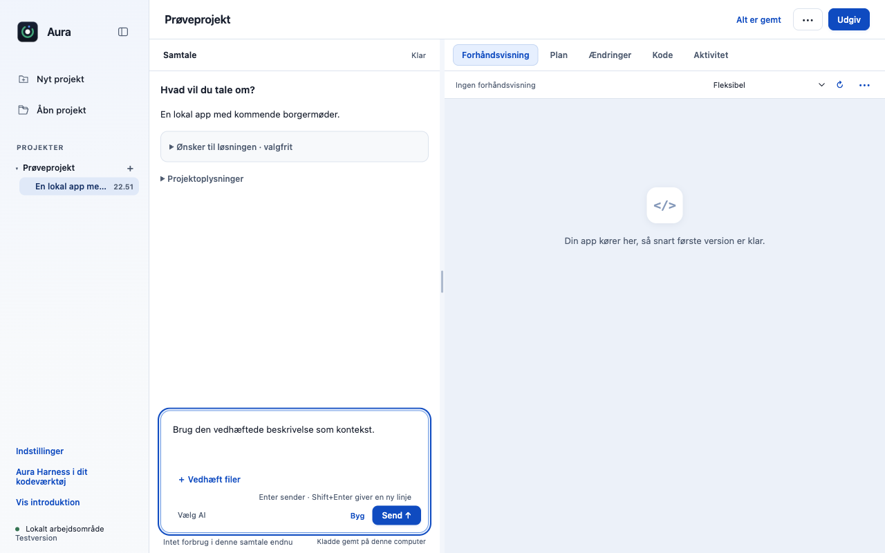
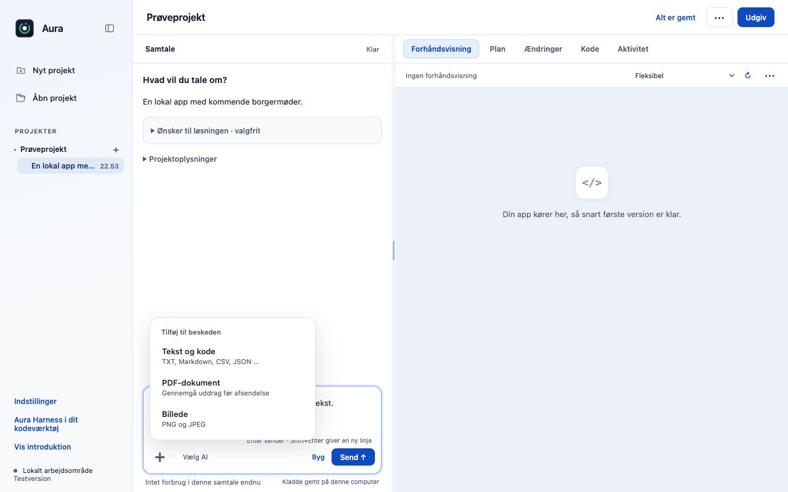

# F15: Gennemgå lokalt udtrukket PDF-tekst før deling i chatten

Udtræk afgrænset PDF-tekst lokalt og gennemgå den med sidetal før deling; ingen OCR, PDF-JavaScript eller eksterne URL’er. Chatfeltets separate vedhæftningsknapper samles i én plusmenu. Denne gren tilbyder tekst, kode, PNG/JPEG og PDF-tekst.

## Bevaring og afgrænsning

De konkrete snapshots, ejerskab pr. samtale, hashbinding, indholdsgrænser og modtagergennemgang bevares. Valg giver ikke AI’en filstier, skriverettigheder eller en generel tilladelse. Menuen understøtter tastatur, Escape, fokus tilbage og lukning ved samtaleskift/aktiv opgave. Hver PR viser kun sine egne understøttede filtyper.

## Afprøvning af denne opdatering

- 24/24 fokuserede automatiske prøver består på macOS Apple Silicon med Node 22.23.3.
- Native Electron-prøve: 3 kontroller, ingen rendererfejl. Genkør med `node desktop/scripts/verify-contribution-update.cjs materials` efter installation af de låste desktopafhængigheder.
- Originalens main `dce68ea` er genprøvet: 514/516 består; to eksisterende fixtures i `approvals.test.cjs` fejler også uden dette bidrag. Den samlede baseline kaldes derfor ikke grøn.
- Kontrollerede testdata bruges til regressions- og UI-prøver. De dokumenterer ikke en ekstern models kvalitet, fysisk Windows/Intel-Mac eller hosted CI.

### Én plusmenu i chatten

| Før denne opdatering | Efter |
|---|---|
|  |  |

Billederne er fra den rigtige Electron-app med separate syntetiske profiler. Ingen HTML/CSS er ændret for at fremstille forskellen. Spørgsmålsbilledet bruger appens rigtige renderer med en kontrolleret samtaletilstand, ikke et påstået live-AI-svar.
