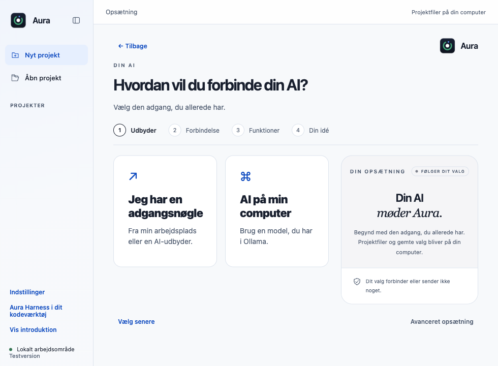
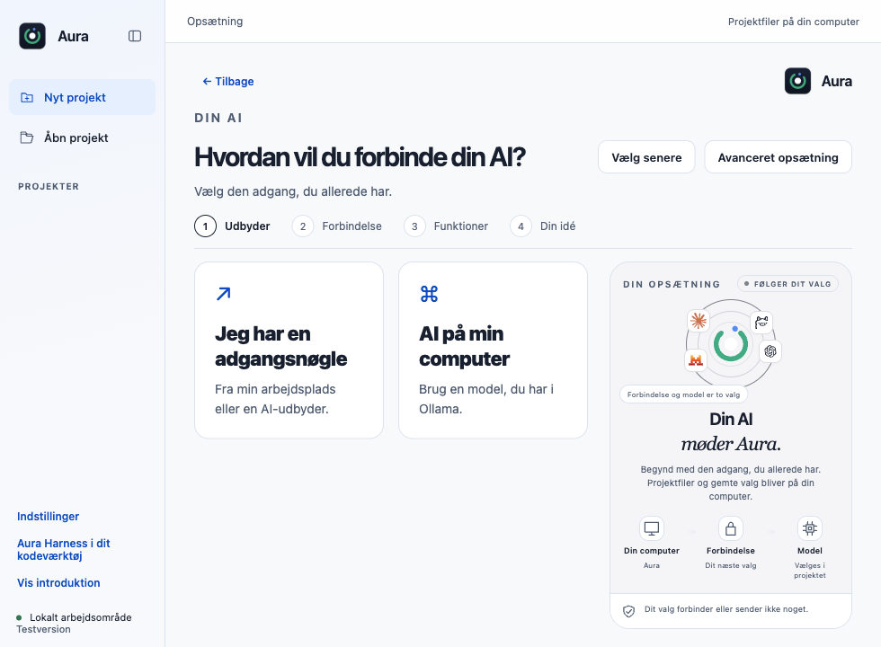
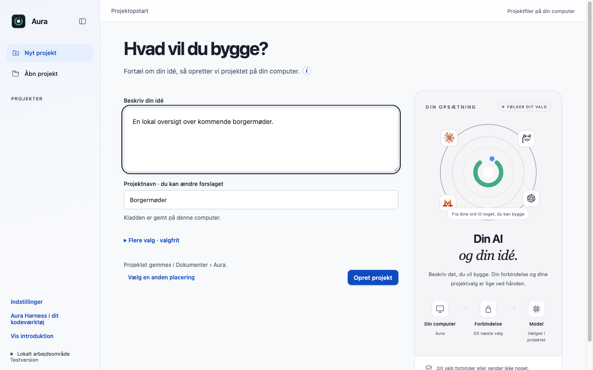
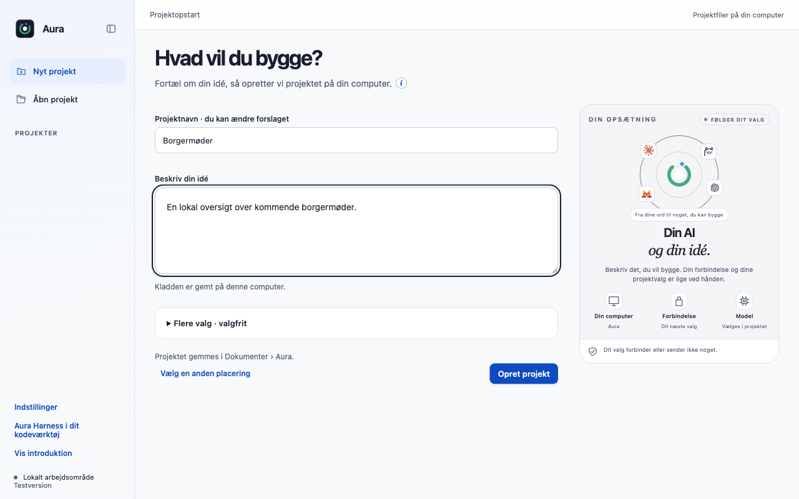

# F20: Visuel onboarding med kompakt opstart og tydelige valg

F20 samler AI-opsætning, projektopstart og modelvalg i onboarding B med store neutrale kort, lokale brandlogoer og en visualisering til højre. Opstartsvinduet maksimeres som et almindeligt vindue; “Vælg senere” og “Avanceret opsætning” står øverst, projektnavnet står over idéfeltet, og de valgfrie felter har samme visuelle sammenhæng.

## Bevaring og afgrænsning

Alle ti udbydere, forbindelseskontrol, katalogsøgning og OpenRouter-ruter bevares. Modelkort kan bruge udgiverlogoet fra #22, når den PR er med. Uden #22 fungerer kortene stadig. Der tilføjes ingen AI-idéhjælp eller ekstra obligatoriske onboardingtrin.

## Afprøvning af denne opdatering

- 7/7 fokuserede automatiske prøver består på macOS Apple Silicon med Node 22.23.3.
- Native Electron-prøve: 7 kontroller, ingen rendererfejl. Genkør med `node desktop/scripts/verify-contribution-update.cjs onboarding` efter installation af de låste desktopafhængigheder.
- Originalens main `dce68ea` er genprøvet: 514/516 består; to eksisterende fixtures i `approvals.test.cjs` fejler også uden dette bidrag. Den samlede baseline kaldes derfor ikke grøn.
- Kontrollerede testdata bruges til regressions- og UI-prøver. De dokumenterer ikke en ekstern models kvalitet, fysisk Windows/Intel-Mac eller hosted CI.

### Kompakt opstart ved 980 × 720

| Før denne opdatering | Efter |
|---|---|
|  |  |

### Projektnavn og idé

| Før denne opdatering | Efter |
|---|---|
|  |  |

Billederne er fra den rigtige Electron-app med separate syntetiske profiler. Ingen HTML/CSS er ændret for at fremstille forskellen. Spørgsmålsbilledet bruger appens rigtige renderer med en kontrolleret samtaletilstand, ikke et påstået live-AI-svar.
