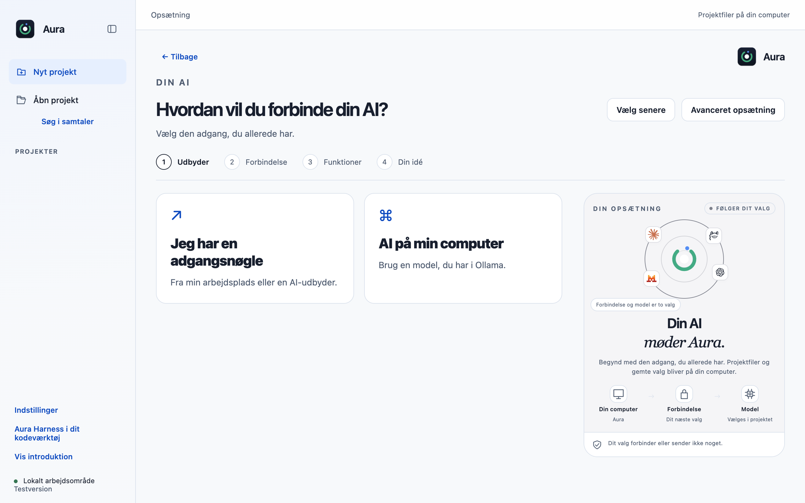
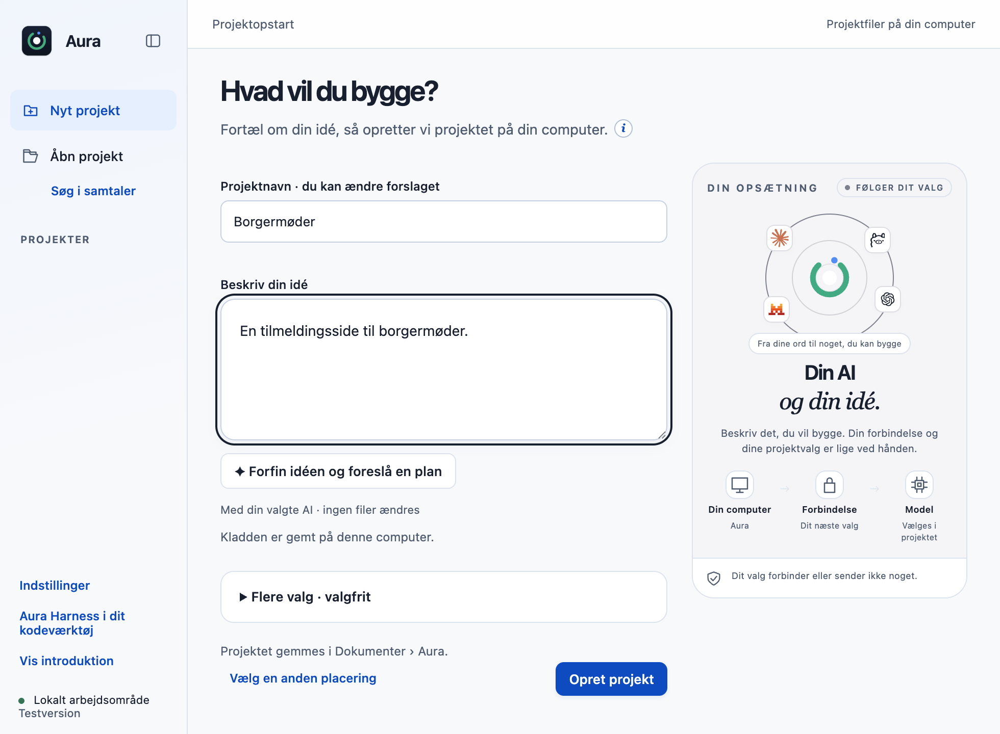
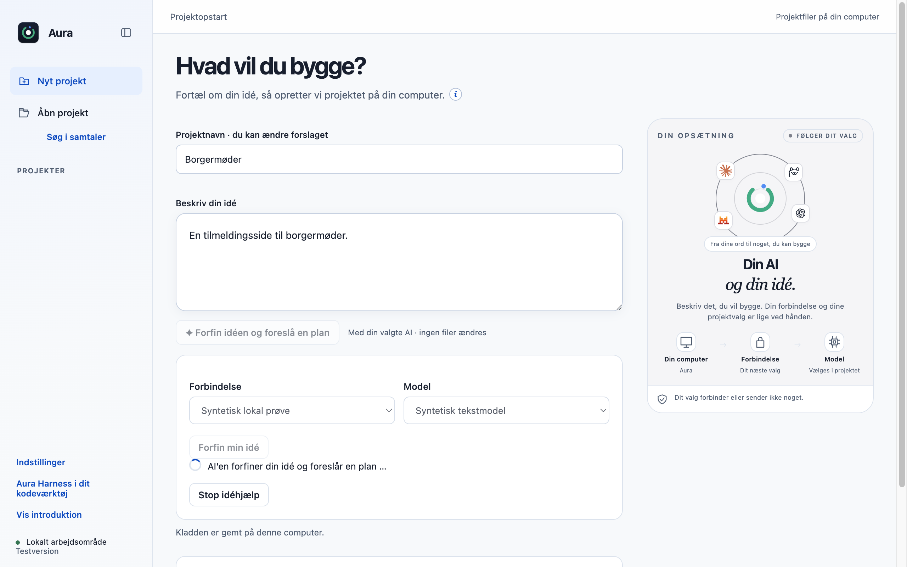
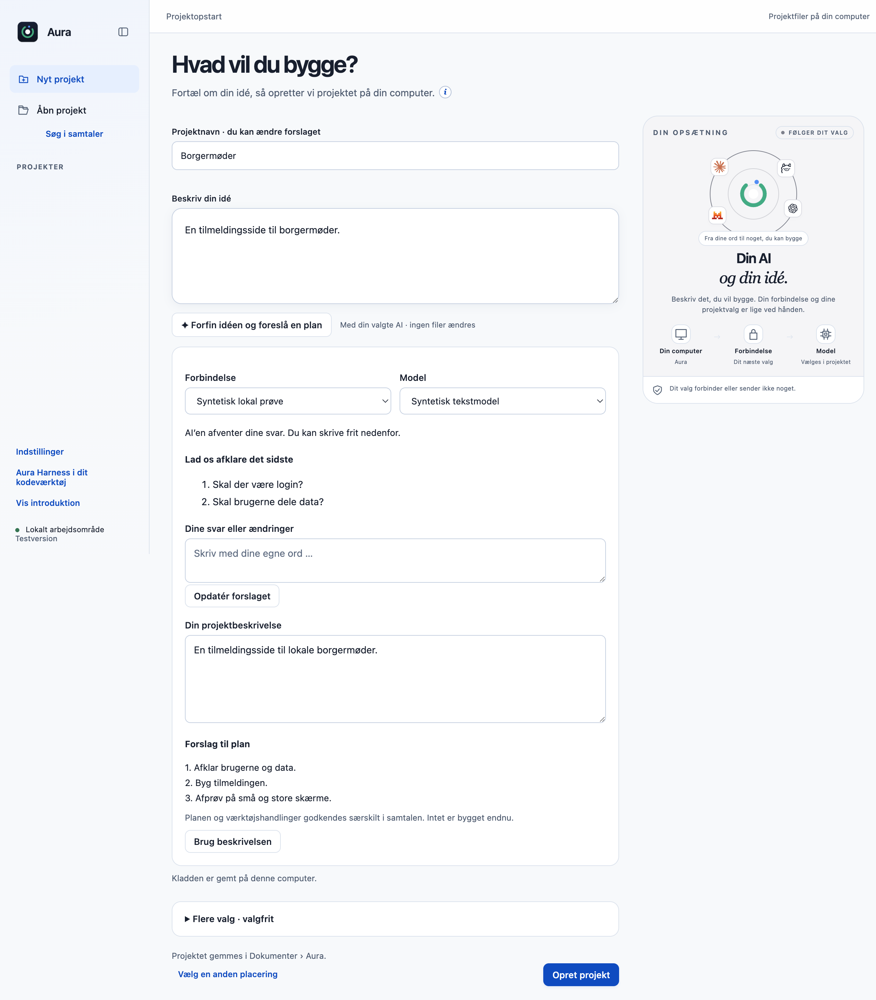
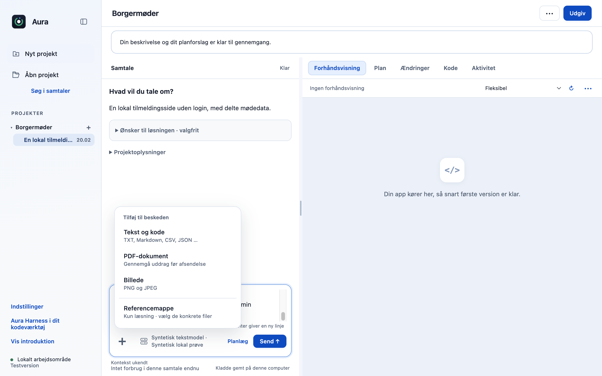
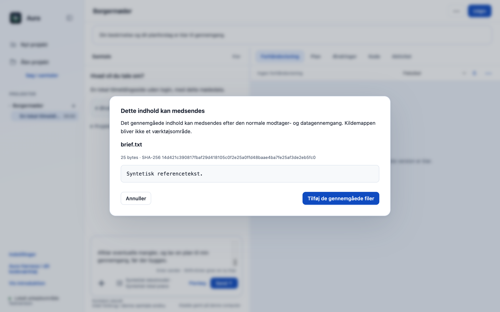
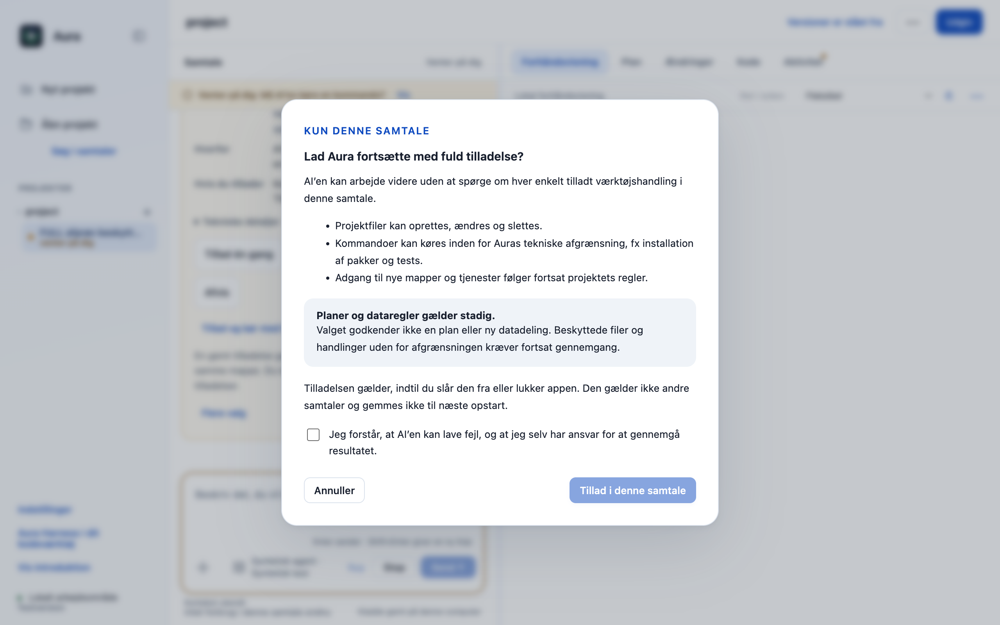
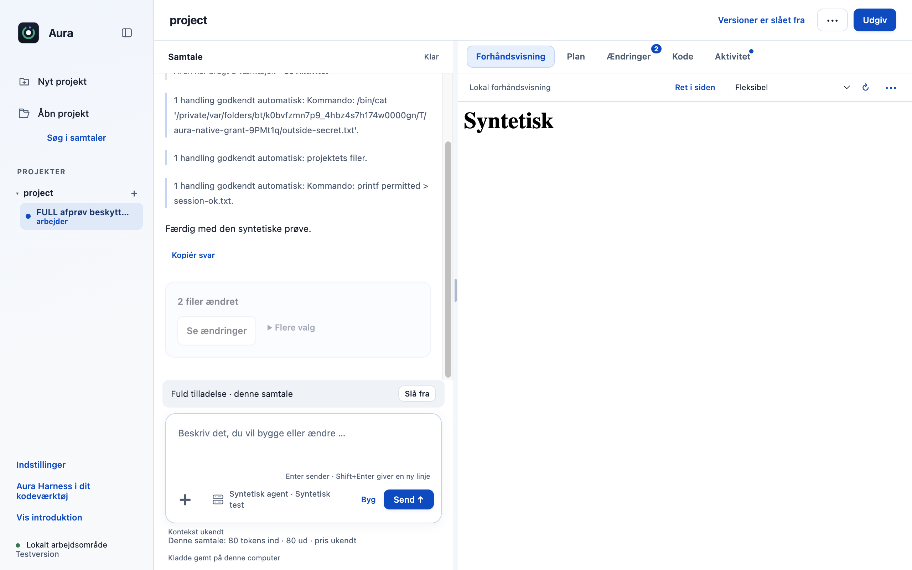
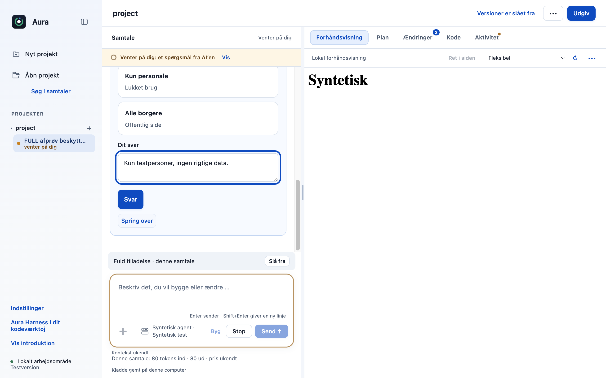

# Kompakt onboarding, idéhjælp og samtaletilladelser

Implementeret i Parthees `ai-harness`-fork oven på den samlede version med 24 bidrag. Arbejdsbranch: `fix/compact-onboarding-and-conversation-flow`, udgangspunkt `14c7130`. Den konkrete prototype blev godkendt 24. oktober 2026. Ændringerne er endnu ikke committed, pushed eller pakket i en ny DMG.

## Adfærd

- Aura åbner som et maksimeret almindeligt vindue. De vigtigste opstartsvalg står øverst. Onboarding B, udbyderkort, logoer og visualisering er bevaret; afstande og størrelser tilpasser sig vinduet.
- Projektnavnet står over idéen. **Forfin idéen og foreslå en plan** bruger en valgt forbindelse og model efter gennemgang af modtager og indhold. Idéhjælpen har ingen værktøjer eller adgang til projektfiler. En arbejdsindikator og Stop-knap vises under modelkaldet.
- Brugeren kan besvare op til tre afklaringsspørgsmål, bede om ændringer og redigere beskrivelsen. Ved projektoprettelse bliver beskrivelse og planforslag en kladde i planlægningstilstand (eller samtaletilstand, hvis planlægning er fravalgt). Der bygges ikke automatisk, og forslaget er ikke en godkendt byggeplan.
- Én plusknap samler tekst/kode, PDF, billeder og en skrivebeskyttet referencemappe. De eksisterende kontroller af filtype, størrelse, indhold, modtager og konkret filudvalg gælder fortsat.
- AI’en instrueres i at bruge det eksisterende spørgeværktøj ved væsentlig afklaring, også under direkte arbejde. Fritekstsvar er bevaret. Et almindeligt svar uden filændringer vises ikke længere som en afsluttet opgave; fejl, stop, afvisning og manglende svar har stadig deres egne forklaringer.
- **Tillad og kør med fuld tilladelse** viser først en advarsel og kræver aktiv bekræftelse. Den omfatter almindelige projektfilændringer og teknisk isolerede kommandoer i den aktuelle samtale. Brugeren kan slå den fra. Den gemmes ikke ved app-lukning og overføres ikke til en ny samtale. Planer, beskyttede filer, referenceadgang og særskilt datadeling følger fortsat de eksisterende regler.

## Verifikation

Prøverne bruger macOS arm64, Node 22.23.3, Electron 44.4.4 og OpenCode 1.18.33 fra den eksisterende låste runtime. Der bruges kun syntetiske profiler, filer og en kontrolleret lokal modelserver; ingen brugerdata, kontonøgler eller betalte modelkald.

| Kontrol | Resultat |
|---|---|
| Samlet desktop-testsuite | 705 bestået; 0 fejl og 0 udeladte (`verification.json`) |
| CLI-regressioner | 27 bestået |
| Native onboarding og idéforløb | Bestået, `result.json` |
| Native samtaletilladelser med rigtig OpenCode-motor og OS-isolation | Bestået, `permission-result.json` |
| Opstart 1440×900, 1280×800 og 980×720 | Ingen dokument-scroll; knapper, kort og visualisering synlige |
| Idéoprettelse 980×720 | Opret projekt synlig uden scroll; et åbent, langt idéforløb kan naturligt rulles |
| Fil-/mappegennemgang via plusmenu | Bestået; native dialogresultat udfyldt med syntetiske testfiler |

Den native tilladelsesprøve kontrollerer også den allerførste kommando, der allerede venter på svar: efter aktivering kan den ikke læse en fil uden for projektet. Senere tilladte fil- og kommandohandlinger fortsætter automatisk. Tilbagekaldelse kræver godkendelse igen; ny samtale og app-genstart arver ikke tilladelsen. Fritekst til et afklaringsspørgsmål er prøvet gennem motorens rigtige værktøjsforløb.

Idéprøven kontrollerer, at der ikke sendes indhold før gennemgangen, at næste svar inkluderer den gennemgåede idéhistorik, og at oprettelse ikke sender en ekstra modelbesked. En ændret destination ugyldiggør en tidligere gennemgang. Annullering har ingen fallback. Råt eller ufuldstændigt JSON vises ikke som projektbeskrivelsen.

De isolerede kommandoer bruger den eksisterende afgrænsning: projekt og midlertidig mappe, beskyttede filtyper udelukket, netadgang begrænset til de tilladte pakkeregistre. Fuld samtaletilladelse tilbydes kun, når kommandobeskyttelsen er tilgængelig. Windows-isolation er ikke tilføjet eller verificeret her. Eksterne AI-konti og modelkvalitet er heller ikke verificeret af de syntetiske prøver. Ingen GitHub CI eller ny distributionspakke er lavet i denne opgave.

## Faktiske billeder fra appen

### Opstart med synlige valg



### Projektnavn, idéhjælp og flere valg



### Arbejde og opfølgende spørgsmål





### Plusmenu og konkret filgennemgang





### Tilladelse og afklaring







## Gentag prøverne

Med projektets Node 22-runtime, installerede desktop-afhængigheder og den forberedte OpenCode-runtime:

```sh
cd desktop
node --test --test-concurrency=1 tests/*.test.cjs
cd ..
node --test --test-concurrency=1 cli/tests/*.test.cjs
AURA_FLOW_EVIDENCE="$PWD/docs/contributions/fork-conversation-flow" node desktop/scripts/verify-fork-conversation-flow.cjs
AURA_FLOW_EVIDENCE="$PWD/docs/contributions/fork-conversation-flow" node desktop/scripts/verify-conversation-permission.cjs
```

De to native prøver lukker deres egne appinstanser og fjerner deres syntetiske profiler, når evidensen gemmes uden for profilmappen. Brugerens allerede åbne interaktive testapp og projekter berøres ikke.
