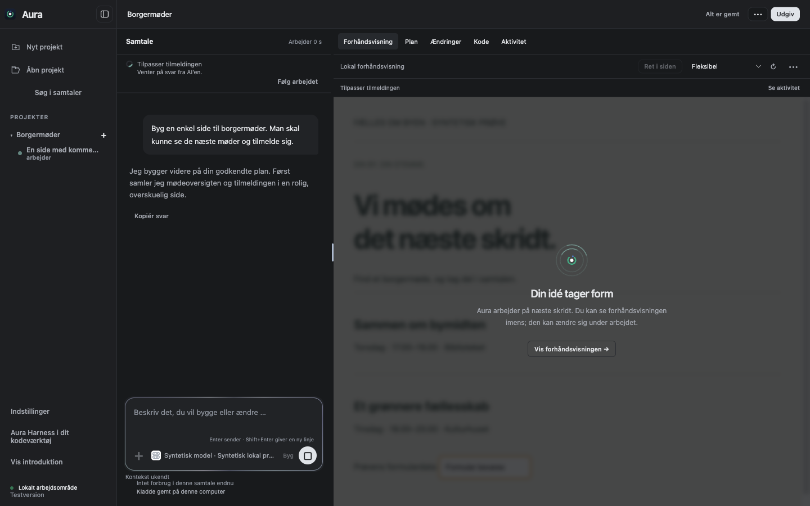
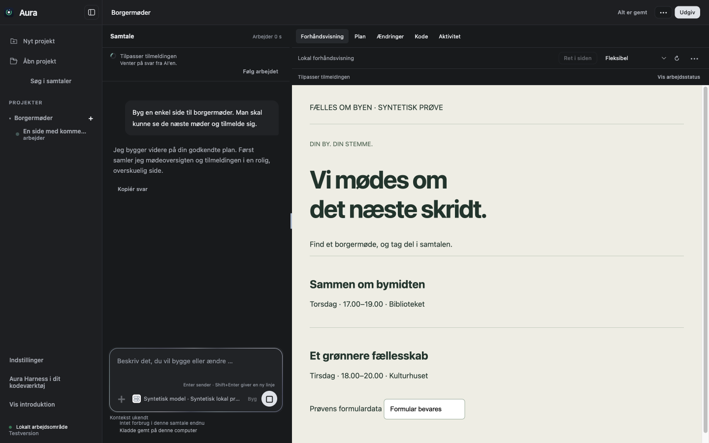
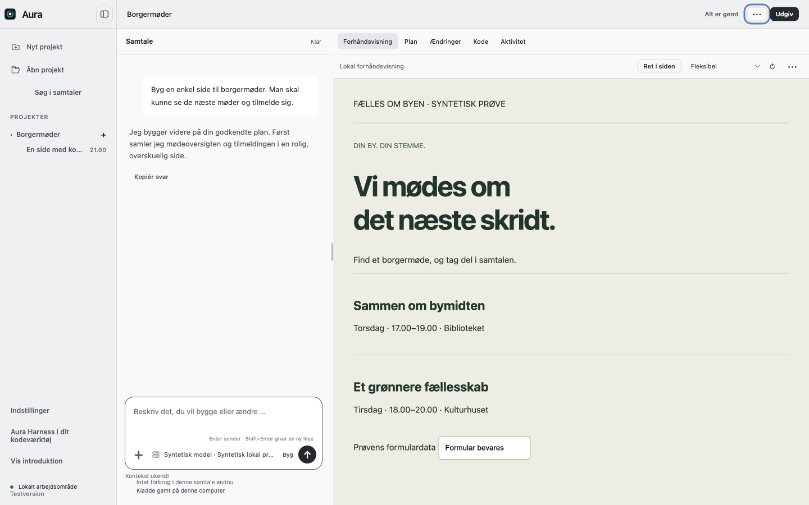
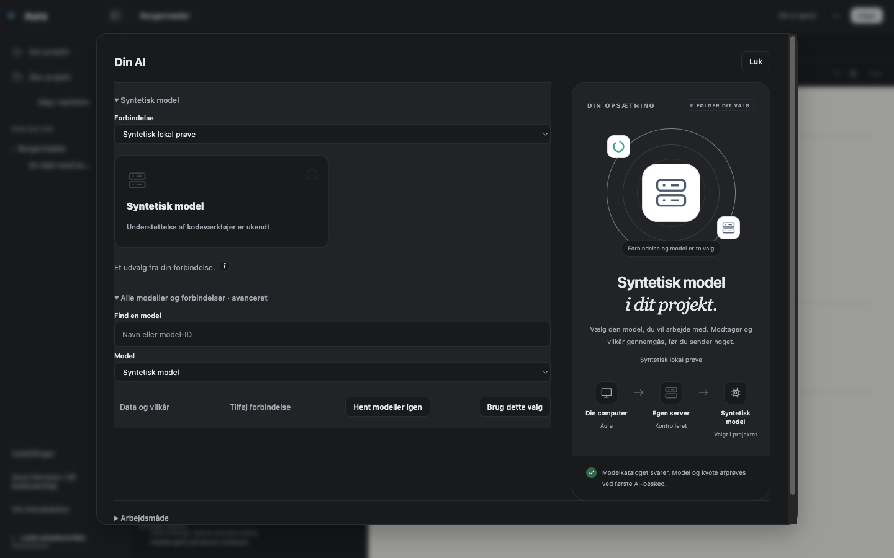
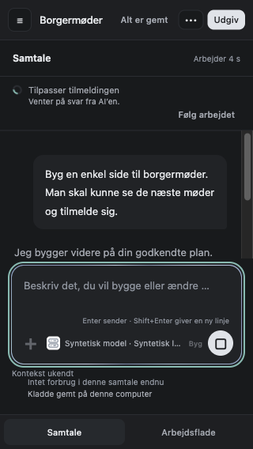
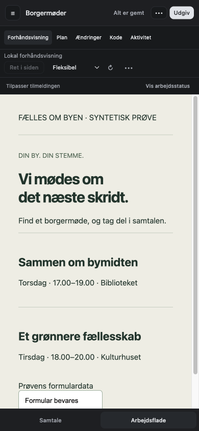

# Godkendt rolig arbejdsvisning

Den 24. oktober 2026 godkendte Parthee [den konkrete prototype](https://mac-studio-tilhrende-parthee.tailefb5b1.ts.net/aura-ui/fork-workspace-calm-20261024/) med “Godkend og byg det ind”. Ændringen ligger i den samlede fork `Parthee-Vijaya/ai-harness`, på `fix/compact-onboarding-and-conversation-flow`.

## Det, brugeren får

- Mørke, neutrale flader som standard i arbejdsvisningen. Under projektmenuen kan man vælge lys arbejdsvisning; valget gemmes lokalt.
- En roligere samtale med én plusmenu, kompakt modelvalg og de eksisterende oplysninger om kontekst og forbrug.
- Diskret bevægelig kant, når den aktuelle samtale arbejder. Kanten står stille, når AI’en venter på et svar eller en godkendelse.
- Arbejdsstatus ved forhåndsvisningen. **Vis forhåndsvisningen** åbner den kørende side, mens opgaven fortsætter. Brugeren kan åbne arbejdsstatus igen.
- Direkte vej fra en ventestatus til det rigtige spørgsmål eller den rigtige godkendelse.
- På små skærme kan brugeren skifte mellem samtale og arbejdsflade og åbne projekterne som et sidepanel. Ingen funktioner skal forsvinde ud over vinduets kant.

Onboarding B, opstartens godkendte kompakte design, idéhjælp, planer, filer, historik, modelvalg, værktøjsgodkendelser og fuld tilladelse til den aktuelle samtale bevares. Projektets egen forhåndsvisning får ikke Auras farver påtvunget. Farverne på modeldialogens eksisterende kort og visualisering følger arbejdsvisningens tema.

## Afgrænsning

Arbejdsvisningen sender ingen beskeder, giver ingen tilladelser og ændrer ikke agentmotorens regler. Status og lyskant læser den aktuelle samtales eksisterende tilstand. Vis/skjul-valget hører til samtalen og den konkrete kørsel, så det ikke smitter til andre samtaler.

Forhåndsvisningen bliver i samme iframe. Den bliver midlertidigt utilgængelig for tastaturet, når arbejdsstatus dækker den, og bliver tilgængelig igen ved **Vis forhåndsvisningen**. Sandbox, adresse, formulardata og fanernes tilstand bevares. Den eksisterende opdatering ved faktiske filændringer er fortsat aktiv.

## Verifikation

- 719 desktoptests bestået, ingen fejl eller oversprungne tests.
- 63 kontroller bestået i den native Electron-prøve af arbejdsvisningen: se [resultat og alle kontroller](validation.json).
- Vinduesstørrelser: 1440 × 900, 1280 × 800, 980 × 720, 900 × 700, 720 × 650, 390 × 844 og 320 × 568. De mindste størrelser bruges i prøven ved midlertidigt at sænke testvinduets minimumsmål; appens normale minimumsmål ændres ikke.
- Mørkt og lyst tema, bevaret temavalg ved genindlæsning, tastaturstyrede faner, reduceret bevægelse, systemets kontrastfarver, plusmenu og modeldialog kontrolleret.
- Formular i den rigtige lokale forhåndsvisning bevaret ved dæmpning, genåbning og faneskift. Arbejdsstatus fjernes ved afslutning og fejl.
- Native prøve med rigtig OpenCode-motor og kontrolleret lokal modelserver: [resultat](permission-validation.json). Fuld tilladelse kræver aktiv accept, tilbagekaldelse kræver ny godkendelse, tilladelsen følger ikke med til anden samtale eller genstart, og en syntetisk fil uden for projektet kommer ikke til modelserveren. Opfølgende spørgsmål kan besvares med fritekst uden et misvisende afslutningskort.

Arbejdsvisningens tilstandsprøver bruger syntetiske hændelser; tilladelsesprøven bruger den rigtige agentmotor og lokal testserver. Der er ikke brugt rigtige kontonøgler, eksterne modeller eller brugerdata. Det er lokale kildekodeprøver, ikke en ny DMG- eller GitHub CI-verifikation.

Den første tilladelsesprøve manglede den forberedte Node-runtime i udviklingsmappen. Prøven blev gentaget med den korrekte runtime og bestod. Testscriptet afviser nu dette setup straks, før det starter agentforløbet.

## Skærmbilleder fra appen

Billederne viser syntetiske projekter. De er taget fra Electron-appen, ikke fra designprototypen.

| Arbejder | Forhåndsvisning åbnet under arbejdet |
| --- | --- |
|  |  |

| Lys arbejdsvisning | Modeldialog i mørkt tema |
| --- | --- |
|  |  |

| Smal samtale | Smal forhåndsvisning |
| --- | --- |
|  |  |

[Én plusmenu](plus-menu.png) · [Advarsel før fuld tilladelse](permission-warning.png) · [Fritekstsvar på spørgsmål](follow-up-question.png) · [Bevaret onboarding B](onboarding-preserved.png).

## Gentag prøverne

Brug projektets låste Node- og Electron-runtime og de installerede desktopafhængigheder. Tilladelsesprøven kræver også den forberedte Node-runtime, som `command-sandbox.cjs` kontrollerer, og `HARNESS_OPENCODE_PATH` til den låste agentmotor.

```sh
node --test --test-concurrency=1 desktop/tests/*.test.cjs
AURA_FLOW_EVIDENCE=/absolut/sti/til/arbejdsvisning node desktop/scripts/verify-workspace-calm.cjs
AURA_FLOW_EVIDENCE=/absolut/sti/til/tilladelser node desktop/scripts/verify-conversation-permission.cjs
```

Prøverne opretter egne syntetiske profiler og fjerner dem igen, når evidensmappen ligger uden for testmappen. Eksisterende apps, profiler og projekter berøres ikke.

Implementeringen ligger lokalt. Der er ikke lavet commit, push, PR, DMG eller release som del af denne designgodkendelse.
