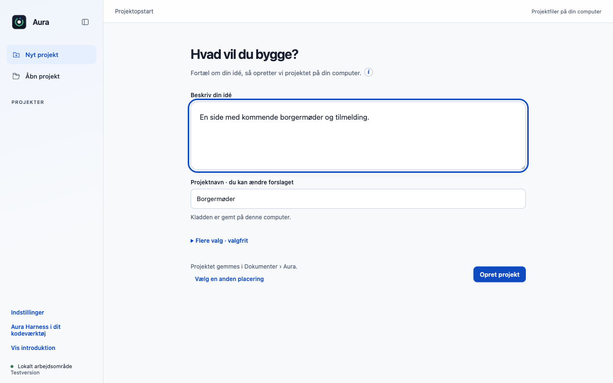
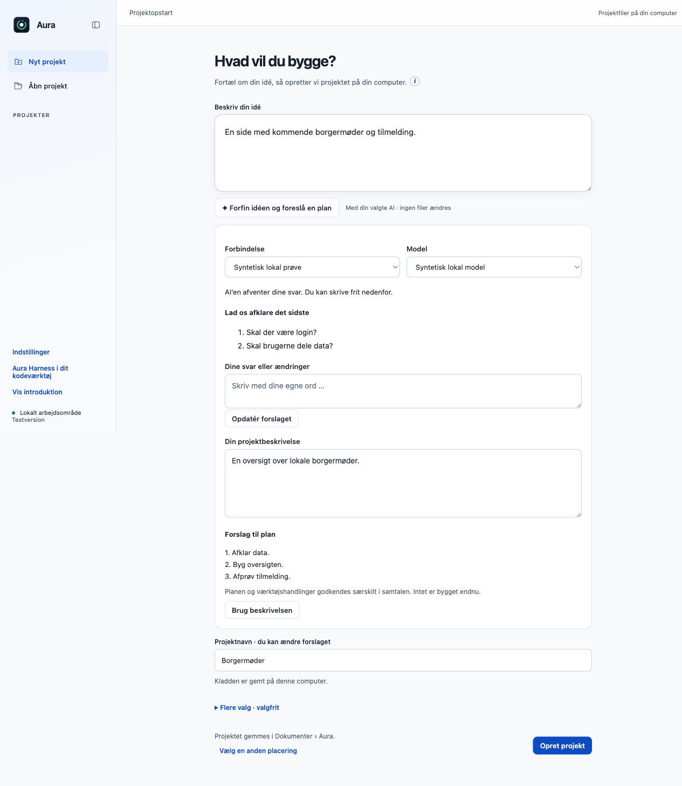
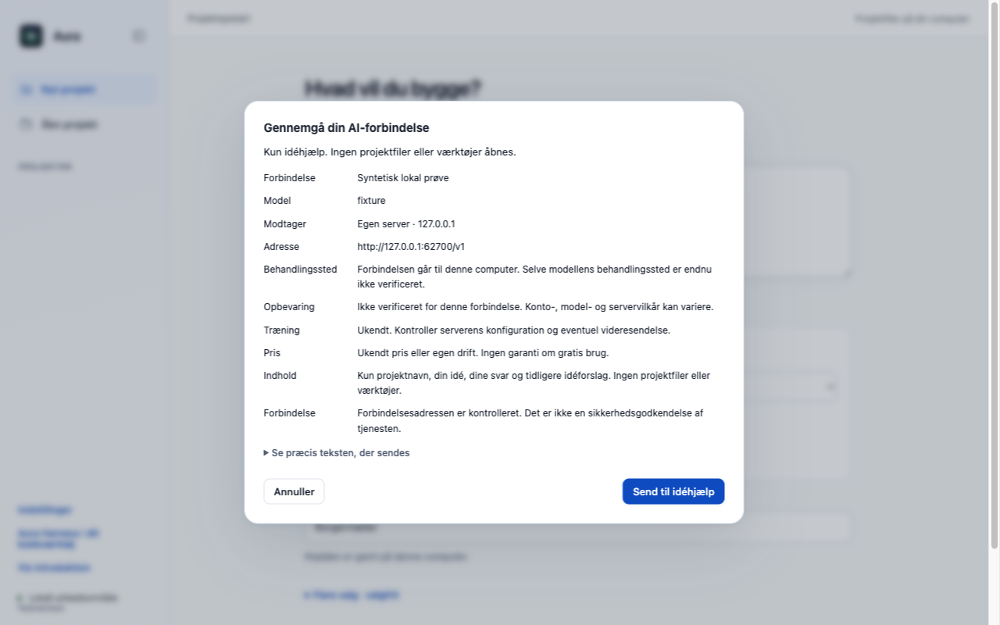
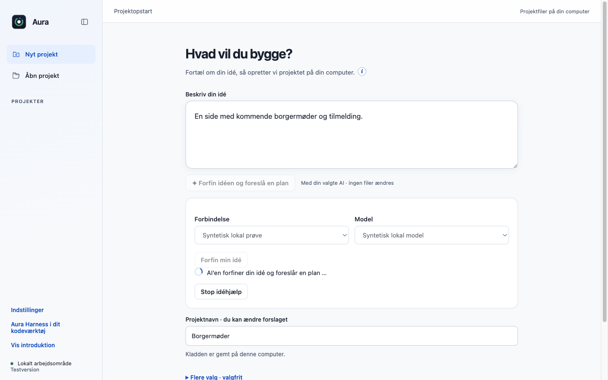
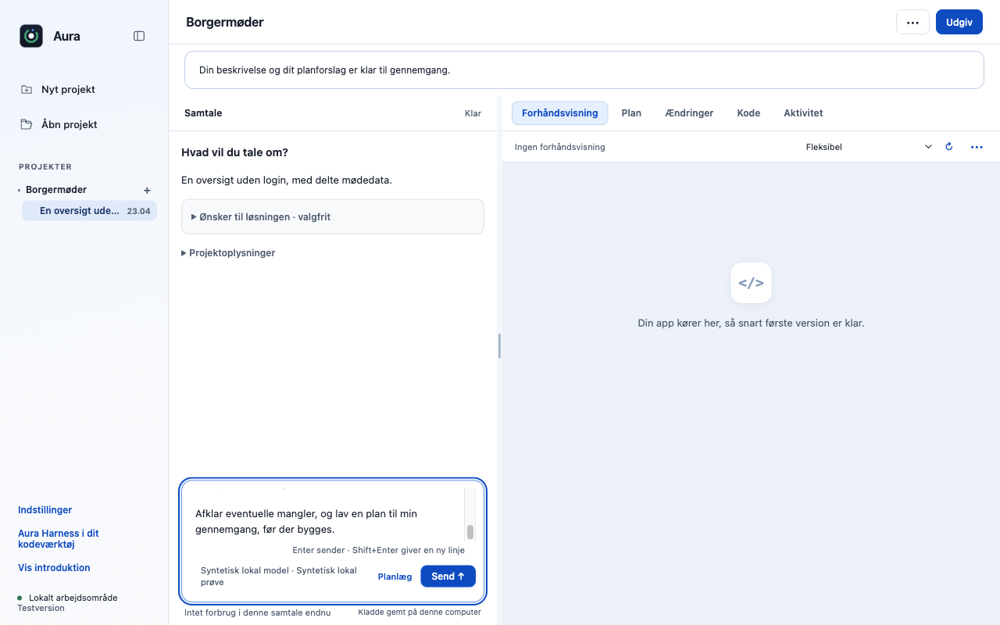

# Forfin idéen med AI før projektet oprettes

En kort idé kan nu bearbejdes til en læsbar beskrivelse og et planforslag, før projektet oprettes. Brugeren kan besvare op til tre spørgsmål med egne ord, ændre beskrivelsen og vælge at tage forslaget med videre.

## Før og efter

| Før | Efter |
|---|---|
| Projektet oprettes direkte fra den første idé; afklaringen sker først bagefter i chatten. | En knap under idéfeltet åbner idéhjælp med valg af forbindelse/model, konkret datagennemgang, synlig arbejdsstatus og et redigerbart forslag. |

| Inden idéhjælp | Læsbar beskrivelse og spørgsmål |
|---|---|
|  |  |

### Gennemgang før afsendelse



### Synligt AI-arbejde



### Planforslaget er stadig en kladde



## Adfærd og bevaring

- Idéhjælpen er et tekstkald uden agentværktøjer og projektfiladgang. Kun navn, idé, svar, tidligere forslag og de viste instruktioner indgår.
- Modtagervalg, input og instruktioner bindes til en tidsbegrænset engangsgennemgang og kontrolleres igen før afsendelse. Ingen automatisk cloudfallback.
- JSON læses som strukturerede felter; brugeren ser beskrivelse, plan og spørgsmål. Fejl, afbrydelse og for store svar bevarer brugerens tekst.
- Ved oprettelse lægges forslaget i chatfeltet i Planlæg. Det starter ikke bygning og godkender hverken plan eller værktøjer.

## Test

7/7 modulprøver og 7 native Electron-kontroller består. Den native prøve gennemfører to rigtige lokale HTTP-kald: gennemgang → arbejdsstatus → spørgsmål → brugerens svar → nyt forslag → projekt med plankladde.

Prøverne er kørt lokalt på macOS Apple Silicon med Node 22.23.3 og appens låste afhængigheder. De er ikke en påstand om grøn GitHub CI.

Originalens uændrede main har 514/516 beståede desktoptests. To eksisterende fixtures i `approvals.test.cjs` (linje 47 og 74) fejler også uden dette PR. Den isolerede branches fulde testlog er vedlagt; disse to fejl er ikke skjult eller sprunget over.

```sh
node --test desktop/tests/idea-refinement.test.cjs
node desktop/scripts/verify-contribution-new.cjs . idea idea-refinement-after
# Hele desktop-pakken:
cd desktop && node --test --test-concurrency=1 tests/*.test.cjs
```

Evidens: [focused.tap](focused.tap), [full.tap](full.tap), [native.json](native.json).

## Integration

Den lokale samlingsprøve med de tidligere 24 bidrag, de ti opdateringer og disse syv nye bidrag består **746/746 desktoptests og 27/27 CLI-tests**. Den bruger forkens integrerede grundlag; fælles filer er flettet med bevarede bindinger, og alle 23 skill-eksporter er genbygget. Det er ikke en påstand om konfliktfri automatisk merge eller grøn hosted CI. [Manifest](integration.json), [desktoplog](integration-desktop.tap) og [CLI-log](integration-cli.tap).

Kan gennemgås selvstændigt på originalens main. Ved kombination med F20 (#17) bevares det flyttede projektnavn og kompakte layout. Den lille build-design-hjælper deles med aktiverings-PR’et og skal kun findes én gang.

Originalt sammenligningspunkt: `dce68ea74a199ca214ab535a16ff22765d8ee8de`. Funktionerne er udskilt fra den godkendte fork-implementering `fa223d3b2ceb6f27e5fecf4c13f590913801036c`; originalens navn, runtimeversion og øvrige produktfunktioner bevares.

## Afgrænsning

Ingen live ekstern model er brugt til denne PR-prøve. Billederne viser den faktiske app med kontrollerede forslag. Screenshots som input og ændring af eksisterende projekter er ikke en del af dette afgrænsede idéflow.
