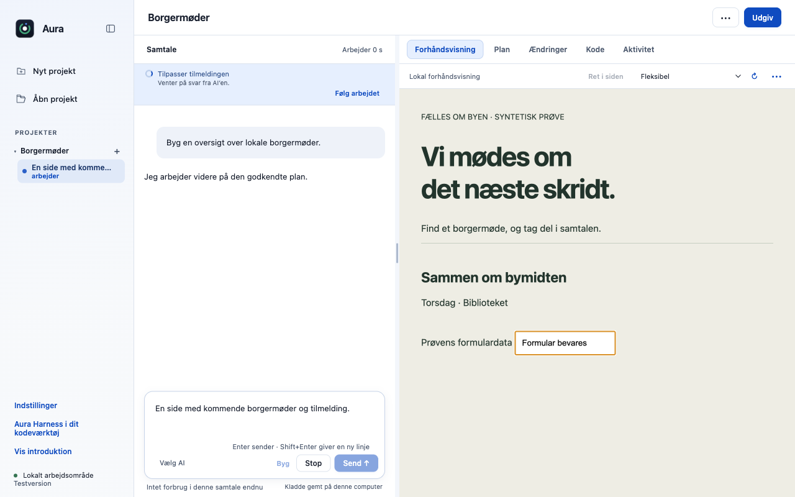
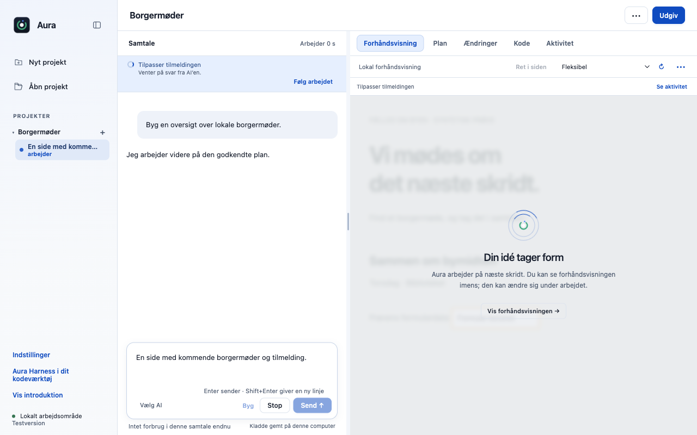
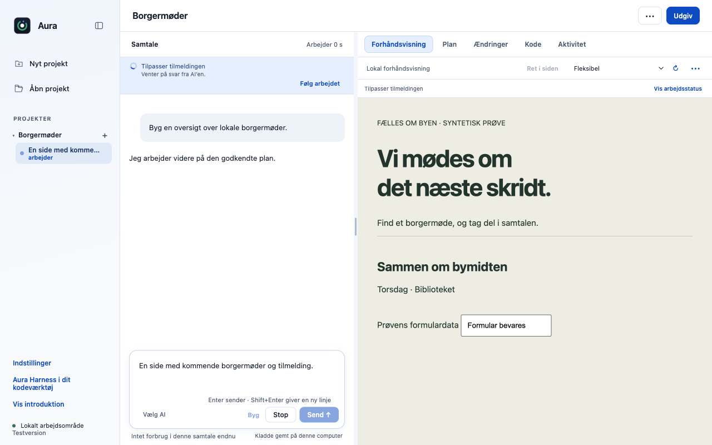

# Vis arbejdsstatus over forhåndsvisningen uden at genindlæse den

Når agenten arbejder, viser forhåndsvisningen en diskret status med mulighed for at se siden alligevel. Ved et ventende spørgsmål eller en godkendelse leder knappen til det faktiske valg i samtalen.

## Før og efter

| Før | Efter |
|---|---|
| Forhåndsvisningen giver ingen tilsvarende forklaring på, at siden kan være midlertidigt ufuldstændig under arbejde. | Arbejdsstatus, “Vis alligevel” og adgang til ventende valg samles over previewet. Den eksisterende iframe og dens formulardata bevares. |

| Preview under arbejde før | Arbejdsstatus over previewet |
|---|---|
|  |  |

### Siden kan vises mens agenten arbejder



## Adfærd og bevaring

- Status følger den aktive samtale og forsvinder ved afslutning eller fejl. Skift af samtale viser ikke en anden samtales arbejde.
- Den dækkede arbejdsflade er inert for tastaturet. “Vis alligevel” ændrer kun synligheden og stopper ikke agenten.
- En ventende handling åbner/fokuserer det rigtige spørgsmål eller den rigtige godkendelse; knappen giver ingen tilladelse.
- Reduceret bevægelse respekteres. Modulet virker også på originalens tema og kan kombineres med den rolige arbejdsvisning.

## Test

12 native Electron-kontroller består: overlay, tastaturinerthed, bevarede formulardata og iframe-URL, vis/skjul, ventende spørgsmål, samtaleskift, reduceret bevægelse og fejltilstand.

Prøverne er kørt lokalt på macOS Apple Silicon med Node 22.23.3 og appens låste afhængigheder. De er ikke en påstand om grøn GitHub CI.

Originalens uændrede main har 514/516 beståede desktoptests. To eksisterende fixtures i `approvals.test.cjs` (linje 47 og 74) fejler også uden dette PR. Den isolerede branches fulde testlog er vedlagt; disse to fejl er ikke skjult eller sprunget over.

```sh
node desktop/scripts/verify-contribution-new.cjs . preview preview-working-after
# Hele desktop-pakken:
cd desktop && node --test --test-concurrency=1 tests/*.test.cjs
```

Evidens: [full.tap](full.tap), [native.json](native.json).

## Integration

Den lokale samlingsprøve med de tidligere 24 bidrag, de ti opdateringer og disse syv nye bidrag består **746/746 desktoptests og 27/27 CLI-tests**. Den bruger forkens integrerede grundlag; fælles filer er flettet med bevarede bindinger, og alle 23 skill-eksporter er genbygget. Det er ikke en påstand om konfliktfri automatisk merge eller grøn hosted CI. [Manifest](integration.json), [desktoplog](integration-desktop.tap) og [CLI-log](integration-cli.tap).

Præsenteres særskilt fra mørkt arbejdsområde. Hvis begge vælges, deles adgang til samtalepanelet via det valgfrie calmWorkspace-interface; previewets status ejer ikke samtalens plan- eller godkendelseslogik.

Originalt sammenligningspunkt: `dce68ea74a199ca214ab535a16ff22765d8ee8de`. Funktionerne er udskilt fra den godkendte fork-implementering `fa223d3b2ceb6f27e5fecf4c13f590913801036c`; originalens navn, runtimeversion og øvrige produktfunktioner bevares.

## Afgrænsning

Prøven viser faktisk Electron-rendering med syntetisk arbejds-/spørgsmålstilstand. Der afsendes ingen ekstern modelanmodning i denne UI-prøve.
