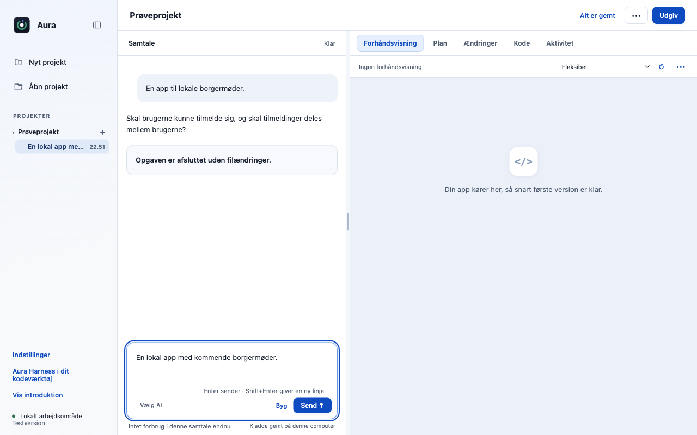
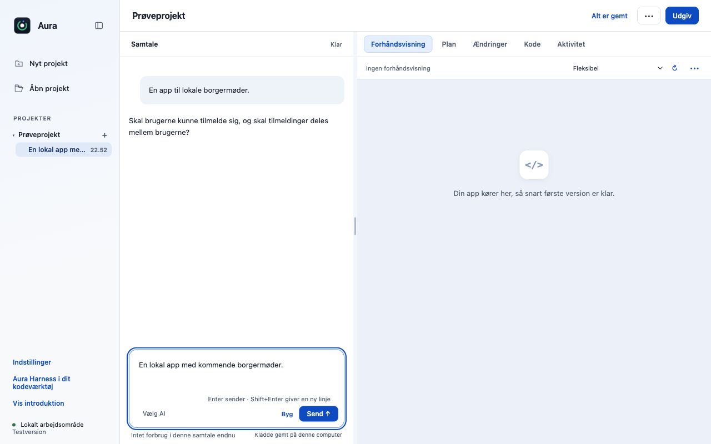

# R01: Bind spørgsmål til aktiv opgave og bevar samtalen under afklaring

Et AI-spørgsmål skal tilhøre den opgave, der stillede det. R01 afviser forældede svar, låser dobbeltklik og kontrollerer motor/session før og efter kvittering. Samtidig guides AI’en til højst tre nødvendige spørgsmål i alle arbejdsmåder og til at lade brugeren skrive sit eget svar. Et svar uden filændringer viser ikke længere det misvisende afslutningskort.

## Bevaring og afgrænsning

Planvalg og værktøjstilladelser er separate og uændrede. Fejl, Stop og faktiske filændringer beholder deres resultatvisning. En allerede afsendt anmodning kan ikke tilbagekaldes, og klientlåsen lover ikke præcis én serverbehandling ved et tvetydigt netudfald.

## Afprøvning af denne opdatering

- 20/20 fokuserede automatiske prøver består på macOS Apple Silicon med Node 22.23.3.
- Native Electron-prøve: 2 kontroller, ingen rendererfejl. Genkør med `node desktop/scripts/verify-contribution-update.cjs questions` efter installation af de låste desktopafhængigheder.
- Originalens main `dce68ea` er genprøvet: 514/516 består; to eksisterende fixtures i `approvals.test.cjs` fejler også uden dette bidrag. Den samlede baseline kaldes derfor ikke grøn.
- Kontrollerede testdata bruges til regressions- og UI-prøver. De dokumenterer ikke en ekstern models kvalitet, fysisk Windows/Intel-Mac eller hosted CI.

### Afklaring uden falsk afslutning

| Før denne opdatering | Efter |
|---|---|
|  |  |

Billederne er fra den rigtige Electron-app med separate syntetiske profiler. Ingen HTML/CSS er ændret for at fremstille forskellen. Spørgsmålsbilledet bruger appens rigtige renderer med en kontrolleret samtaletilstand, ikke et påstået live-AI-svar.
