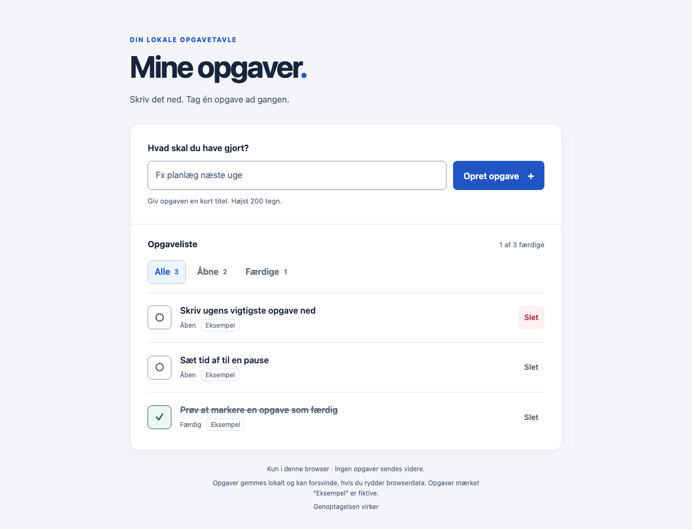
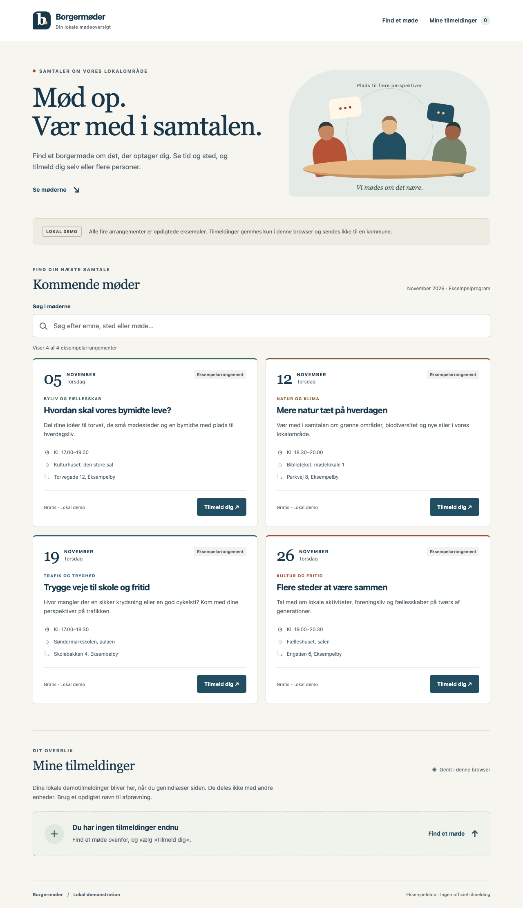

# Genforsøg og genoptagelse ved forbindelsesfejl

Aura kunne tidligere afslutte hele opgaven efter to minutters stilstand i modelkaldet eller et brud i agentens aktivitetsstrøm. Brugeren skulle sende beskeden igen, selv om agenten muligvis stadig arbejdede.

Ændringen genopretter transporten omkring den eksisterende opgave. Brugerfladens layout, onboarding, modelvalg, funktioner, planlægning og godkendelsesregler bevares. Status vises i den eksisterende aktivitet.

## Adfærd

- Efter to minutter uden data giver Aura samme modelkald yderligere tre minutter. Nye datapakker nulstiller stilstandsuret. En samlet grænse på 20 minutter omfatter både kald, ventetid og genforsøg.
- Før noget svarindhold er leveret til agenten kan samme forespørgsel prøves højst tre gange. De almindelige pauser er ét og tre sekunder. HTTP 408, 429, 500, 502, 503 og 504 kan udløse genforsøg. En gyldig `Retry-After` respekteres op til ét minut; længere varslede kvoteperioder afsluttes med en forklaring.
- Forespørgslens model, udbyderrute, historik, vedhæftninger, indsats og adgangsoplysninger er identiske mellem forsøg. Ingen automatisk reserveudbyder, modelswitch eller ny samtale bruges. Genforsøg kan medføre modelomkostninger, selv hvis første forsøg ikke nåede frem til appen.
- En tabt aktivitetsforbindelse genåbnes højst tre gange med stigende pauser. Aura henter samme sessions beskeder, værktøjsresultater, forbrug, ventende spørgsmål og godkendelser. Ved genopretning bruges hele tekstdele fra motoren, så overlappende tekstbidder ikke bliver dobbeltvist.
- Mistet kvittering for en brugerbesked undersøges via beskedens entydige ID. Aura sender ikke brugerbeskeden igen. Et ukendt resultat giver en forklaring frem for en mulig dobbelt udførelse.
- **Stop** og lukning annullerer ventetid og genforsøg. Loginfejl, manglende adgang og permanente afvisninger genprøves ikke.
- Et forsinket afslutningssignal fra en tidligere besked kan ikke afslutte den næste besked, før dens eget svar er modtaget. Sammenfatning af lange samtaler har sin egen afslutningskontrol efter genforbindelse.
- En transportfejl fjerner ikke den eksisterende plan. Et nyt byggeforsøg gennemgår stadig de gældende kontekst- og tilladelsesbindinger.

## Grænsen for automatisk genoptagelse

Dette er ikke en garanti for præcis én udførelse hos enhver ekstern tjeneste. Når modelindhold allerede er leveret, kan agenten have påbegyndt et værktøjskald. Aura gentager derfor **ikke** en delvist leveret modelstrøm eller en ukendt fil-/terminalhandling. Et fortsat afbrudt svar afsluttes som fejl med bevaret samtale, plan og filændringer, så brugeren kan gennemgå resultatet. Det vises ikke som brugerens Stop.

Aktivitetsgenopretning genudfører ingen værktøjer. Samme godkendelses-ID bevarer sin oprindelige binding; besvarede godkendelser kan ikke genopstå fra en forsinket aflæsning. Projektets faste regler og afgrænsninger gælder fortsat.

Agentmotorens egne tidsgrænser ligger 30 sekunder efter gatewayens samlede grænse. Ellers kunne OpenCodes standard på fem minutter afbryde gatewayens første genforsøg. Det er kontrolleret mod den låste OpenCode 1.18.33-konfiguration.

## Afprøvning

Automatiske regressioner dækker blandt andet:

- Langsomt første svar, grace-periode, stilstand, heartbeats, HTTP-fejl, `Retry-After`, samlet deadline og maksimalt antal forsøg.
- Byte-identisk modelindhold og samme modtager mellem forsøg; ingen gentagelse af en delvist leveret værktøjsstrøm, heller ikke ved en pæn men afkortet HTTP-afslutning.
- Genforbindelse, mistet slutstatus, overlappende tekst, gendannelse af værktøjer/forbrug, bevaret godkendelsesbinding og afvisning af gamle godkendelses-ID'er.
- Stop under genforsøg, lukning under opstart, mistet promptkvittering, bevaret plan samt samme session og godkendelser under genopretningen.
- De eksisterende kontroller af projektgrænser, modelruter, plan-/bygtilstande, nøgler, billeder, sessionshukommelse og øvrige funktioner.

Kør fra repositoryets rod med den låste Node-runtime:

```sh
node --test --test-concurrency=1 desktop/tests/*.test.cjs
```

**746 af 746 automatiske tests bestod** på den endelige kode. [Maskinlæsbare resultater](timeout-recovery/verification.json).

### Rigtig AI i den native app, 24. oktober 2026

To webapps blev bygget gennem den faktiske Electron-app og OpenCode 1.18.33: en opgavetavle og en borgermødeoversigt. Modellen var GPT-6.1-Sol gennem en midlertidig lokal protokoladapter til den autentificerede Codex CLI. Adapteren leverede ægte modelsvar og værktøjsvalg; Aura udførte filhandlingerne gennem sine almindelige godkendelser. Adapteren skrev ikke projektfiler. Der blev brugt eksempeldata, ingen rigtige borgersager eller leverandørnøgler i rapporten.

- Tre HTTP 503-fejl blev indsat før videresendelse til den rigtige model i bygge- og hukommelsesprøverne. Alle blev genprøvet med byte-identisk forespørgsel og samme destination.
- Agentens rigtige hændelsesforbindelse blev afbrudt, mens en filændring afventede godkendelse. Den samme godkendelse blev genfundet, og den aftalte HTML-ændring blev udført én gang. CSS og JavaScript var uændrede.
- Samtalen fortsatte efter genstart og genforbindelse. En efterfølgende besked nåede den rigtige model og kunne omtale det eksisterende projekt og den netop tilføjede note.
- En særskilt prøve genforbandt den eksisterende samtale, sammenfattede den med rigtig AI og bad om en ny forklaring af appens funktioner og datalagring. Svaret beskrev de fire møder, tilmelding/afmelding og localStorage korrekt. Alle filer var uændrede.
- AI-prøven fandt et forsinket afslutningssignal, som oprindeligt kunne afslutte næste besked for tidligt. Det blev rettet, dækket af en regressionstest og prøvet igen med rigtig AI.
- Begge genererede apps blev bagefter prøvet i Chromium: oprettelse, filtrering, sletning, søgning, validering, tilmelding, afmelding og genindlæsning. **13 browserkontroller bestod**, uden JavaScript-fejl og uden vandret afskæring ved 390 px.
- Separat native regression: **63 kontroller** af den godkendte arbejdsvisning, navigation, preview, små vinduer og onboarding bestod. Godkendelsesprøven bestod også: fuld tilladelse holdt sig til samtalen, kunne tilbagekaldes og ophævede ikke projektets filgrænser.

Browserkontrollen blev udført af testværktøjet efter AI-bygningen. I mødeprøven afviste den stramme testfører to ekstra terminalkontroller; de tælles ikke som beståede AI-kontroller. Browserprøverne er selvstændigt observerede resultater, ikke AI'ens egen beskrivelse.





[Se mobilformularen](timeout-recovery/meetings-mobile.png).

### Afgrænsning

De kontrollerede transportfejl er bevidst fremkaldt, men modelsvar, værktøjsvalg, native godkendelser og genererede filer er rigtige. Adapteren sendte heartbeats, mens Codex udarbejdede svaret; gradvis tokenstreaming, stilstand og delvise værktøjsstrømme dækkes særskilt af transporttestene. Resultaterne dokumenterer denne konfiguration, ikke alle modeller hos Mistral, Corti eller andre udbydere.

GitHub CI og installationspakker er særskilte kontroller; denne ændring udgiver ingen DMG.
